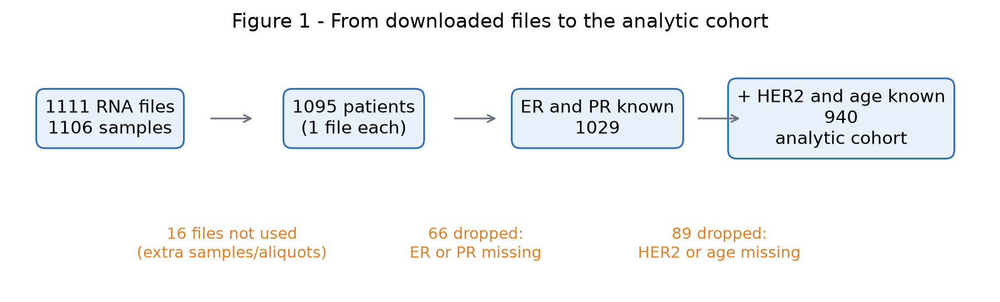
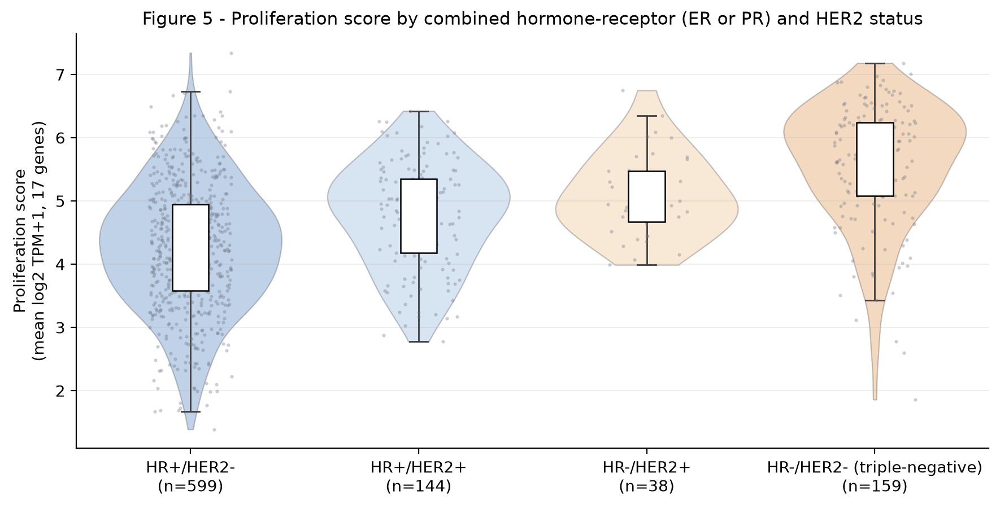

# Tumour Proliferation and Receptor Status in TCGA-BRCA

Individual statistics project (Path B, multimodal: clinical + RNA-Seq). Data: NCI Genomic Data Commons, project TCGA-BRCA, open-access files.

> **Status:** Phase 1 (data understanding, audit and descriptive analysis).

## Statistical question

Among TCGA-BRCA patients with RNA-Seq and complete ER, PR, HER2 status and age, is a proliferation-related expression score associated with receptor status, and does RNA expression (luminal-related score, *ERBB2*) carry information about the score beyond the clinical receptor status? See [`PROJECT_CARD.md`](PROJECT_CARD.md) for the full statement.



## Data in brief

| Item | Value |
|---|---|
| GDC data release active on download date (2026-10-21) | 46.0 |
| RNA-Seq files (STAR - Counts, GENCODE v36) | 1,111 |
| Unique patients with RNA | 1,095 (one file selected per patient) |
| Patients with clinical data | 1,098 |
| Analytic cohort (RNA + ER, PR, HER2, age) | 940 (reconfirm after final HER2-rule rerun) |

Unit of analysis: the patient. Raw data are **not** included in this repository (see [`data/README.md`](data/README.md)).



## Repository structure

```text
data/
  metadata/       GDC manifest and sample sheet (tracked)
  raw/            GDC downloads (not tracked)
  processed/      tables produced by the notebooks (not tracked)
figures/          figures produced by the notebooks
notebooks/        analysis notebooks (run in order)
reports/          phase reports (PDF)
PROJECT_CARD.md   project definition
requirements.txt  Python dependencies
```

## Notebooks (run in order)

| Notebook | Content |
|---|---|
| `01_data_inventory_id_mapping` | Files and table levels, RNA-to-patient mapping, one RNA file per patient |
| `02_clinical_audit_receptors` | Clinical audit, ER/PR/HER2 definitions, missing data |
| `03_rna_extraction_molecular_audit` | RNA extraction, file quality, gene panel, proliferation and luminal scores |
| `04_integration_descriptives_final_question` | Data flow, included vs excluded patients, descriptive analysis, final question |

## Reproducing

```bash
pip install -r requirements.txt
jupyter notebook notebooks/
```

Place the GDC downloads in `data/raw/` as described in [`data/README.md`](data/README.md), then run the notebooks 01 to 04. Notebook 01 queries the GDC API only when the aliquot lookup cache is absent or incomplete; the lookup is cached. The first run of Notebook 03 reads all 1,095 selected RNA files and caches the extracted molecular panel and QC outputs.

## Main decisions

- **One RNA file per patient** by a fixed rule: smallest sample ID, then smallest aliquot ID, then file ID. The 16 unused files remain documented in `rna_selection_audit.csv`; they are not deleted from the raw data.
- **Receptor status:** ER and PR from IHC; HER2 from definitive FISH/ISH if available, otherwise definitive IHC; equivocal or conflicting results are missing. The HER2 conflict rule must be applied before the final cohort size is frozen.
- **Scores:** proliferation-related score = mean log2(TPM+1) of the 17 project-defined genes; luminal-related score = mean z-score of *ESR1, PGR, FOXA1, GATA3*. The proliferation panel is motivated by published PAM50/ROR proliferation gene sets, but is not identical to the 18-gene Prosigna ROR component and is not a validated clinical signature. The exact list, overlap and exclusions are documented in `PROJECT_CARD.md` and `data/README.md`.
- **Known limitations:** receptor tests have no usable date/timepoint; excluded patients are not a random subset; bulk RNA mixes cell types; the 17-gene score is project-defined and exploratory.

## Data source and gene-panel references

- Grossman RL et al. Toward a shared vision for cancer genomic data. *N Engl J Med*. 2016;375:1109–1112. [DOI: 10.1056/NEJMp1607591](https://doi.org/10.1056/NEJMp1607591).
- TCGA Research Network. Comprehensive molecular portraits of human breast tumours. *Nature*. 2012;490:61–70. [DOI: 10.1038/nature11412](https://doi.org/10.1038/nature11412).
- Parker JS et al. Supervised risk predictor of breast cancer based on intrinsic subtypes. *J Clin Oncol*. 2009;27:1160–1167. [DOI: 10.1200/JCO.2008.18.1370](https://doi.org/10.1200/JCO.2008.18.1370).
- Buus R et al. Development and validation for research assessment of Oncotype DX® Breast Recurrence Score, EndoPredict® and Prosigna®. *npj Breast Cancer*. 2021;7:15. [DOI: 10.1038/s41523-021-00216-w](https://doi.org/10.1038/s41523-021-00216-w).
- The Role of Proliferation in Determining Response to Neoadjuvant Chemotherapy in Breast Cancer: A Gene Expression-Based Meta-Analysis. *Clin Cancer Res*. 2016;22(24):6039–6049. [PubMed Central](https://pmc.ncbi.nlm.nih.gov/articles/PMC5161615/).
- GDC: <https://portal.gdc.cancer.gov>.